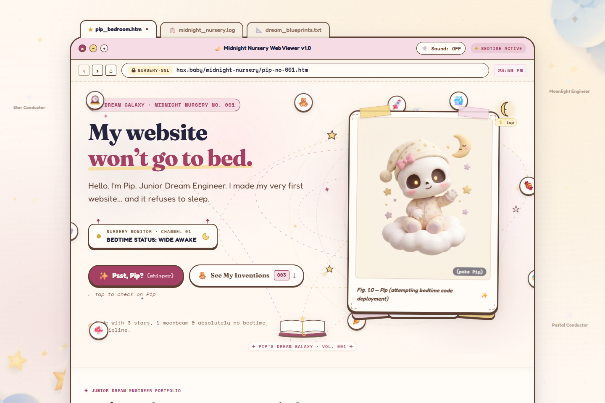
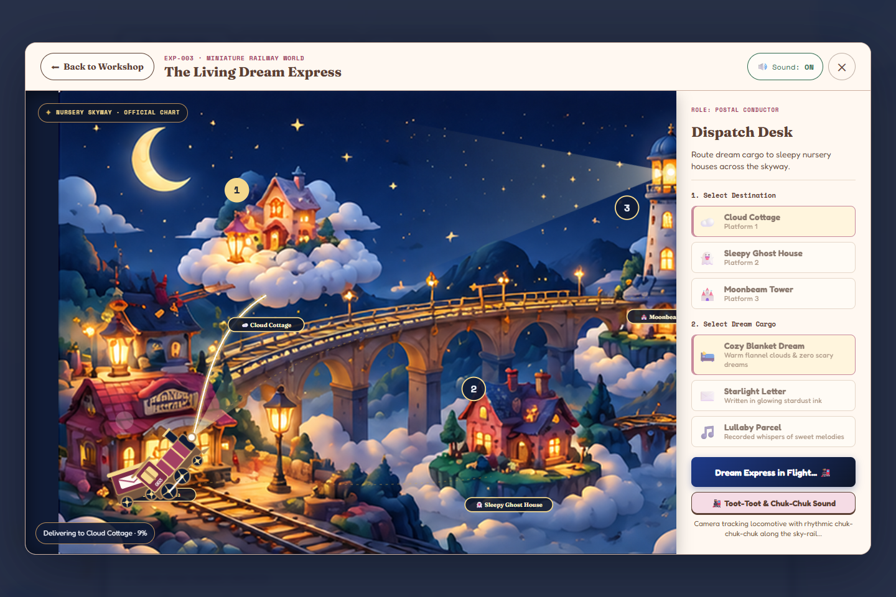
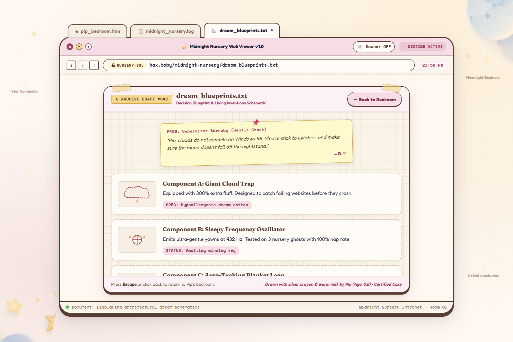
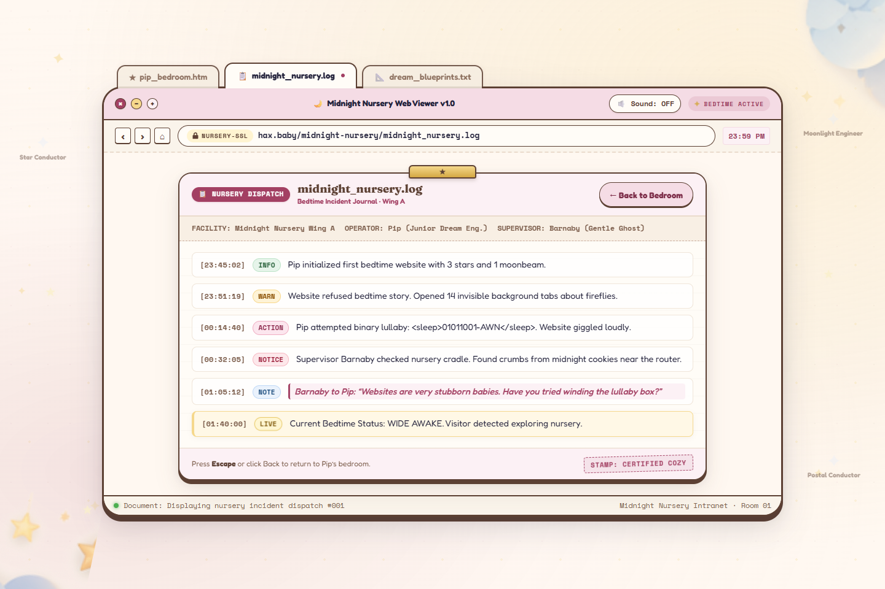
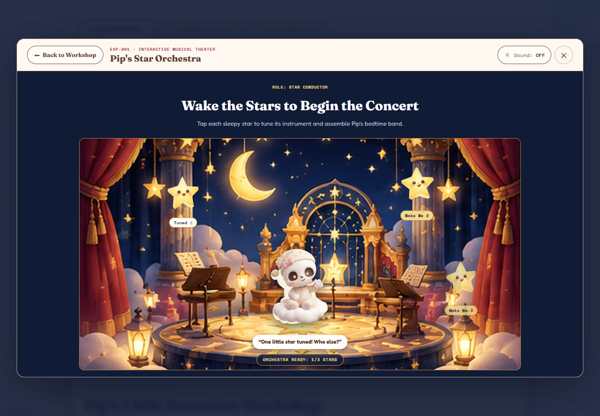
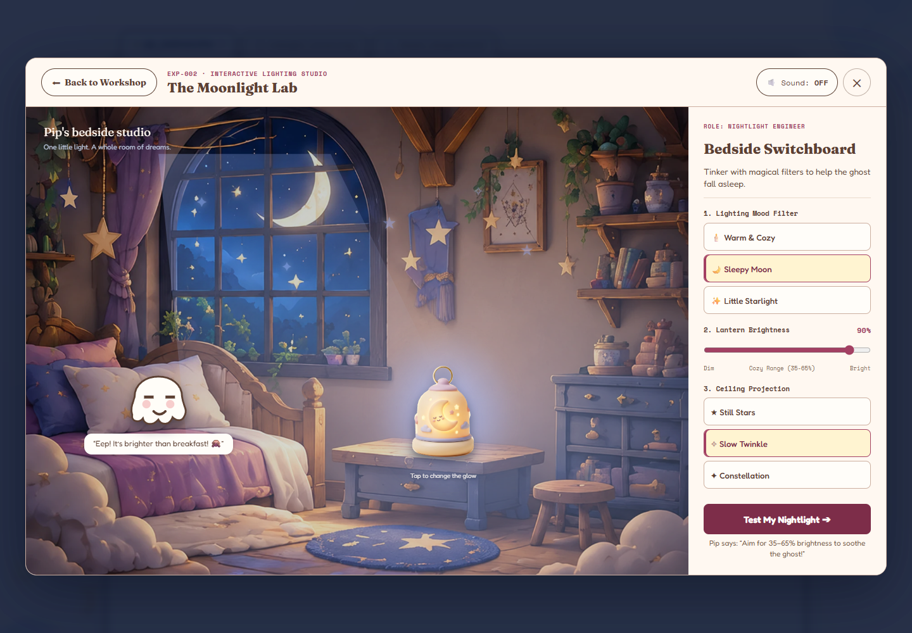

# 🌙 Pip's First Night Shift

       

> **"Shhh! I'm trying to put a WEBSITE to sleep!"**  
> An interactive bedtime sensory storybook and retro-futuristic web playground where visitors embark on Pip’s First Night Shift to gently lull an energetic, sleepless website into a peaceful slumber.

**Live Website:** [https://baby-hax.vercel.app](https://baby-hax.vercel.app)  
**GitHub Repository:** [https://github.com/Mumuksh-Jain/baby-hax](https://github.com/Mumuksh-Jain/baby-hax)

The experience transports bedtime explorers into a cozy paper-craft nursery and cosmic dreamscape where visitors can:
- 🚂 **Drive The Living Dream Express** across articulated sky-rails to deliver bedtime cargo and earn official delivery receipts
- 🎭 **Conduct Pip’s Magical Star Theater Orchestra** using real-time Web Audio procedural lullaby synthesis
- 🏮 **Tune The Moonlight Chamber Lamp** to find the sweet-spot luminance that comforts cozy bedroom ghosts
- 🌌 **Explore the Living Dreamspace & 3D Pip Sculpture** rendered in Three.js with tactile starburst interactions
- 📜 **Unlock Pip’s Bedtime Finale & Collectible Stamps** upon completing all three nursery night-shift directives

---

## 📌 Table of Contents

- [Overview](#-overview)
- [Live Deployment & Demo](#-live-deployment--demo)
- [Screenshots & Visual Tour](#-screenshots--visual-tour)
- [Core Interactive Experiences](#-core-interactive-experiences)
- [Tech Stack](#-tech-stack)
- [System Architecture](#-system-architecture)
- [Audio & Sensory Engine](#-audio--sensory-engine)
- [Project Structure](#-project-structure)
- [Setup & Installation](#-setup--installation)
- [Testing & Quality Verification](#-testing--quality-verification)
- [Accessibility & Responsive Matrix](#-accessibility--responsive-matrix)
- [Future Roadmap](#-future-roadmap)
- [Contributing](#-contributing)
- [Author](#-author)

---

## 📖 Overview

Putting children or busy thoughts to bed is hard—putting a bustling digital website to bed is an extraordinary nocturnal challenge!

**Pip's First Night Shift** is a story-driven, tactile web experience that combines nostalgic retro browser aesthetics, bedtime storybook illustration, procedural Web Audio soundscapes, and lightweight 3D interactive graphics.

### The Bedtime Narrative Arc
1. **The Restless Website:** The nursery is buzzing with active CSS grids, inquisitive pixels, and wide-awake background tasks. Pip has been entrusted with his very first night shift as chief bedtime caretaker.
2. **Three Bedtime Directives:** Pip must complete three essential nursery responsibilities:
   - Route the celestial Dream Express train to ensure sleep dust arrives on schedule.
   - Conduct the celestial Star Orchestra to harmoniously weave a tranquil bedtime lullaby.
   - Adjust the moonlight chamber lantern to cast the exact glow needed for restless ghost companions to sleep.
3. **The Sweet Bedtime Payoff:** Upon gathering all three stamps in the Stamp Tray, the full-screen Bedtime Ending unlocks—dimming the lights, playing the soothing bedtime refrain, and tucking the website safely into sleep mode.

---

## 🚀 Live Deployment & Demo

The application is deployed on Vercel's global edge infrastructure:

- **Production URL:** [https://baby-hax.vercel.app](https://baby-hax.vercel.app)
- **Direct Experience Links:**
  - [Pip's Star Theater & Orchestra](https://baby-hax.vercel.app/?experience=orchestra)
  - [The Moonlight Bedroom Chamber](https://baby-hax.vercel.app/?experience=moonlight)
  - [The Living Dream Express Railway](https://baby-hax.vercel.app/?experience=express)

### Key Deployment Characteristics
- Built with **Vite** into optimized, zero-overhead static assets with modern ES module chunks.
- SPA rewrite routing configured via `vercel.json` for seamless deep-linking to dedicated experience routes.
- Pre-compressed web fonts (`Fraunces`, `Fredoka`, `Space Mono`) bundled directly for zero flash-of-unstyled-text (FOUT).

---

## 📸 Screenshots & Visual Tour

### 🌌 1. The Living Dream Galaxy & Nursery Landing
*Pip's cozy bedtime nursery featuring the 3D interactive Pip sculpture, interactive constellation stars, and whisper dialogues.*


---

### 🚂 2. The Living Dream Express in Flight
*Articulated steam locomotive navigating temporary glowing sky-rails toward the lighthouse dream station.*


---

### 📜 3. Storybook Invention Blueprint
*Pip's tactile blueprint panel detailing dream inventions, gears, and celestial mechanics.*


---

### 🗂 4. Nursery Night Shift Logbook
*Bedtime records, visitor notes, and historical night-shift archive entries.*


---

### 🌟 5. Star Theater & Celestial Conductor Stage
*Real-time interactive star orchestra with celestial conduction podium and harmonic synthesis.*


---

### 🏮 6. Moonlight Bedroom Chamber
*Interactive bedtime lighting slider dynamically tuning ghost companion slumber and room ambience.*


---

## ✨ Core Interactive Experiences

### 🚂 1. The Living Dream Express (`DreamExpressExperience.jsx`)
- **Articulated Locomotive:** Multi-segment physics-like train animation featuring engine, tender, passenger cars, and caboose with puffing steam particles.
- **Interactive Sky-Rails:** Dispatch throttle controls (0% to 100%) that modulate train velocity across curved SVG rail arches.
- **Rotating Lighthouse Beacon:** Sweeping beam that highlights destinations and triggers celestial reactions.
- **Delivery Receipts & Audio:** Earn official stamped delivery certificates upon completing train routes to slumber stops.

### 🎭 2. Pip's Magical Star Theater (`MagicalStarTheater.jsx` & `OrchestraExperience.jsx`)
- **Three Celestial Instruments:** Distinct star-podium buttons triggering harmonized musical layers (Lead Star Chime, Harmonic Moon Swell, Gentle Bass Pulse).
- **Procedural Lullaby Synthesis:** Web Audio API generating real-time musical phrases based on traditional lullaby frequencies (`Twinkle Twinkle Little Star`).
- **Narration Soundscapes:** Optional vocal spoken-word narration chapters (`arrival`, `wish`, `dance`, `listen`, `goodnight`).
- **Retro Achievement Banners:** 8-bit / 90s OS style popups celebrating musical milestones and star conductor achievements.

### 🏮 3. Moonlight Bedroom Chamber (`MoonlightExperience.jsx`)
- **Analog Bedtime Dimmer:** 0% to 100% brightness slider with real-time room lighting adjustments.
- **Dynamic Ghost Companion States:**
  - `< 20%`: *Too Dark!* Ghosts shiver nervously in the pitch black.
  - `20% - 65%`: *Just Right!* Ghosts smile warmly, close their eyes, and drift into peaceful sleep.
  - `> 65%`: *Too Bright!* Ghosts put on sleepy nightcaps or squint at the intense moonbeam.
- **Tactile Paper-Craft Aesthetic:** Custom illustrated bedroom furniture, glowing stars, and cozy floorboards.

### 🌟 4. The Living Dreamspace (`LivingDreamspace.jsx` & `PipStage.jsx`)
- **3D Pip Sculpture:** Built with Three.js featuring interactive orbit/pan rotation, soft studio lighting, and smooth return physics.
- **Reactive Constellation Stars:** Clickable floating stars that burst into glitter particles and chime in chord progressions.
- **Pip's 5 Canonical Reactions:**
  - 💦 *“Shhh! I’m trying to put a WEBSITE to sleep!”* (Panicking politely)
  - ⚠️ *“Careful! If you tap too hard, the CSS grid will wake up!”* (Tip-toeing carefully)
  - 🥛 *“I accidentally spilled warm milk on the bedtime database...”* (Cleaning up with a tiny sponge)
  - 🥱 *“Yawwwn... faaahhh... wait! Don’t look at me, yawns are contagious across HTTP!”* (Dramatic yawn)
  - 🌙 *“Has anyone reviewed my bedtime pull request? The moon is waiting!”* (Code-reviewing dreamy)

---

## 🛠 Tech Stack

### Frontend & Core Engine
| Technology | Version | Purpose |
|------------|---------|---------|
| **React** | 18.3.1 | Component architecture, state transitions, hooks |
| **Vite** | 6.0.7 | Lightning-fast HMR and production bundle optimization |
| **Three.js** | 0.186.1 | WebGL 3D rendering for interactive Pip bedside sculpture |
| **Vanilla CSS** | Modern CSS | Design tokens, paper-craft layers, glassmorphism, responsive typography |
| **Fontsource** | Latest | Self-hosted `Fraunces`, `Fredoka`, and `Space Mono` typography |

### Audio & Sensory Engine
| Technology | Purpose |
|------------|---------|
| **Web Audio API** | Real-time procedural tone generation, envelope shaping, biquad filtering |
| **Custom Sound Engine** | Polyphonic chime scheduler, zero-leak node tracking, sound mute state manager |
| **Voice Audio Buffers** | Decoded audio samples for warm organic vocal hums and spoken narration |

### Quality Assurance & Automated Verification
| Technology | Version | Purpose |
|------------|---------|---------|
| **Puppeteer Core** | 25.14.0 | Multi-viewport screenshot capture and automated behavioral testing |
| **Lighthouse** | 13.5.0 | Performance, Accessibility, Best Practices, and SEO audits |
| **Sharp** | 0.35.5 | Image processing, downscaling, and baseline visual comparison |
| **Node.js Test Runner** | 18+ | Strict assertion test suites (`assert/strict`) |

### Deployment & Infrastructure
| Technology | Purpose |
|------------|---------|
| **Vercel** | Global CDN Edge hosting and instant SPA rewrites |
| **Git / GitHub** | Version control, release tagging, and automated source workflows |

---

## 🧠 System Architecture

```
                       ┌────────────────────────┐
                       │      Web Browser       │
                       │ (Desktop / Tablet / SE)│
                       └───────────┬────────────┘
                                   │
                                   ▼
                       ┌────────────────────────┐
                       │     App Container      │
                       │    (src/App.jsx)       │
                       └─────┬──────┬──────┬────┘
         ┌───────────────────┘      │      └────────────────────┐
         ▼                          ▼                           ▼
┌──────────────────┐      ┌──────────────────┐       ┌────────────────────┐
│  Experience Shell│      │  Living Nursery  │       │ Bedtime Payoff     │
│  & URL Routing   │      │  Stage & ThreeJS │       │ Modal & Guestbook  │
│ (?experience=...)│      │ (PipStage.jsx)   │       │ (BedtimeEnding)    │
└────────┬─────────┘      └─────────┬────────┘       └─────────┬──────────┘
         │                          │                          │
         ├──────────────────────────┼──────────────────────────┘
         │
         ▼
┌────────────────────────────────────────────────────────┐
│             Web Audio Engine (soundEngine.js)          │
│  ┌───────────────────────────────────────────────────┐ │
│  │ Master Gain Bus (Global Mute / Soft Limiter)      │ │
│  └────────┬──────────────────────┬───────────────────┘ │
│           │                      │                     │
│           ▼                      ▼                     ▼
│    Procedural Polyphonic    Narration Sample      Tactile Sound FX
│    Star Chime Synthesizer   Buffer Player         (Pokes, Rustle, Tabs)
└────────────────────────────────────────────────────────┘
```

### Architectural Highlights
1. **Zero-Lag Procedural Audio:** Unlike static MP3 loops that cause network stutter, musical phrases are generated on-the-fly with Web Audio oscillators and envelope filters.
2. **Deep-Link State Isolation:** Each experience can run embedded inside the nursery or isolated in a fullscreen focused shell (`?experience=express|orchestra|moonlight`), automatically synchronizing browser history and Escape key dismissals.
3. **Multi-Stage Performance Optimization:** Heavy 3D WebGL contexts are dynamically suspended when hidden from viewport or when another full-screen modal takes focus.

---

## 🎵 Audio & Sensory Engine

The custom audio engine (`src/utils/soundEngine.js`) is built for child-friendly bedtime relaxation:

- **Strict User Consent:** Audio starts muted by default to comply with browser autoplay policies and protect quiet sleeping environments.
- **Smooth Volume Ramp:** Master gain transitions utilize `linearRampToValueAtTime` over 60ms to prevent audio popping.
- **Harmonic Frequencies:**
  - *Lead Star:* Sine wave at 523.25 Hz (C5) with warm decay.
  - *Second Star:* Harmonic interval at 659.25 Hz (E5) + 783.99 Hz (G5).
  - *Moon Swell:* Soft filtered triangle wave chord at 261.63 Hz (C4) passing through a 400Hz low-pass filter.
- **Tactile Sound Effects:** Subtly textured paper-rustle clicks, cartoon bubble pops, and sleepy sigh audio buffers.

---

## 📂 Project Structure

```text
baby-hax/
├── README.md                            # Complete Project Documentation & Showcase
├── index.html                           # HTML Entry Point with Preloaded Fonts & Meta
├── package.json                         # Dependencies, Scripts & Metadata
├── vite.config.js                       # Vite Configuration & React Plugin
├── vercel.json                          # Vercel Deployment & SPA Rewrite Config
├── .vercelignore                        # Optimized Deployment Exclusion Rules
│
├── public/                              # Static Assets
│   └── assets/
│       ├── audio/                       # Decoded Vocal & Narration Sound Files
│       ├── pip/                         # Pip Character Illustrations & Expressions
│       └── production-art/              # High-Res Backgrounds, Icons & Papercraft Kits
│
├── src/                                 # Application Source Code
│   ├── main.jsx                         # React DOM Entrypoint
│   ├── App.jsx                          # Main Controller, Sound Hooks & Dialogue Bus
│   ├── App.css                          # Layout & Interactive Canvas Styles
│   │
│   ├── components/                      # Modular UI Components
│   │   ├── RetroBrowserFrame.jsx        # Nostalgic Window Wrapper & Titlebar
│   │   ├── HeroSection.jsx              # Welcome Banner & Experience Jump Triggers
│   │   ├── PipStage.jsx                 # Interactive Pip Stage & Whispering Bubbles
│   │   ├── LivingDreamspace.jsx         # Constellation Starfield & Particle Systems
│   │   ├── InventionWorkshop.jsx        # Bedtime Invention Workbench & Tooling
│   │   ├── MagicalStarTheater.jsx       # Star Conductor Stage & Musical Podiums
│   │   ├── BedtimeEndingModal.jsx       # Bedtime Completion Modal & Sleep Payoff
│   │   ├── BedsideStatusSign.jsx        # Retro Nursery Night Shift Status Sign
│   │   ├── NurseryLogPanel.jsx          # Historical Bedtime Logbook
│   │   ├── DreamBlueprintPanel.jsx      # Dream Invention Blueprints
│   │   ├── RetroAchievementPopup.jsx    # Pop-up Notifications & Milestones
│   │   ├── PipOriginStory.jsx           # Animated Storybook Origin Tale
│   │   ├── PipSecretPostcard.jsx        # Collectible Easter Egg Postcard
│   │   ├── CreditsFooter.jsx            # Project Credits & Colophon
│   │   │
│   │   └── club/                        # 3D Graphics & Interactive Widgets
│   │       ├── PipSculpture.jsx         # Three.js Interactive 3D Pip Model
│   │       ├── DreamClub.jsx            # Secret Dream Club Lounge
│   │       └── ScrollJourney.jsx        # Parallax Bedtime Scroll Indicator
│   │
│   ├── experiences/                     # 3 Dedicated Bedtime Experiences
│   │   ├── ExperienceShell.jsx          # Fullscreen Modal Shell with Focus Trap
│   │   │
│   │   ├── express/                     # Experience 1: The Living Dream Express
│   │   │   ├── DreamExpressExperience.jsx
│   │   │   ├── DreamTrain.jsx
│   │   │   └── DreamExpressExperience.css
│   │   │
│   │   ├── orchestra/                   # Experience 2: Magical Star Theater
│   │   │   ├── OrchestraExperience.jsx
│   │   │   └── OrchestraExperience.css
│   │   │
│   │   ├── moonlight/                   # Experience 3: The Moonlight Bedroom
│   │   │   ├── MoonlightExperience.jsx
│   │   │   ├── RoomSet.jsx
│   │   │   └── MoonlightExperience.css
│   │   │
│   │   └── shared/                      # Shared Experience Utilities
│   │       ├── StampTray.jsx            # Collectible 3-Stamp Bedtime Passport
│   │       └── StampTray.css
│   │
│   ├── styles/                          # Global CSS Design System
│   │   ├── tokens.css                   # Color Palette, Radii, Shadows & Typography
│   │   ├── base.css                     # Reset & Core HTML Element Rules
│   │   ├── production.css               # Production Responsive Breakpoints
│   │   ├── local-fonts.css              # Custom Font Face Declarations
│   │   └── finishing.css                # Polished Motion & Micro-interaction Enhancements
│   │
│   └── utils/
│       └── soundEngine.js               # Web Audio API Synthesizer & Audio Coordinator
│
├── scripts/                             # QA & Automated Verification
│   ├── verify-production-redesign.js    # Multi-Viewport Puppeteer Verification Suite
│   └── run-regression.js                # Full Regression & Visual Continuity Tests
│
└── screenshots/                         # Visual Proof & Audit Artifacts
    ├── qa_verify/                       # Core Showcase Screenshots
    ├── rubric/                          # Rubric Verification Captures (1440, 768, 375, 320)
    └── redesign/after/                  # Final Automated Capture Evidence
```

---

## ⚙️ Setup & Installation

### Prerequisites
- **Node.js** 18.0.0 or higher
- **npm** 9.0.0 or higher

### 1. Clone the Repository

```bash
git clone https://github.com/Mumuksh-Jain/baby-hax.git
cd baby-hax
```

### 2. Install Dependencies

```bash
npm install
```

### 3. Launch Development Server

```bash
npm run dev
```

Visit `http://localhost:5173` in your browser.

### 4. Build for Production

```bash
npm run build
```

The production assets will be generated in `dist/`.

### 5. Preview Production Build

```bash
npm run preview
```

Preview runs on: `http://localhost:4173`

*(Optional)* Run with the standalone Node production server:
```bash
npm start
```

---

## 🧪 Testing & Quality Verification

The project includes an automated end-to-end Puppeteer verification suite that validates layout continuity, interaction hitboxes, keyboard traps, audio trigger events, and no-overflow constraints across 5 device viewports:

```bash
# Run the automated multi-viewport verification test suite
npm test

# Run the complete regression test suite
npm run test:regression
```

### Automated Rubric Gates
- **Zero Horizontal Overflow:** Enforces `scrollWidth <= innerWidth` on all viewport widths (1440px, 768px, 414px, 375px, and 320px).
- **Minimum 44x44px Touch Targets:** Validates header buttons, drawer toggles, and sliders meet Apple Human Interface and WCAG touch target standards.
- **Focus Trap & Escape Handling:** Tests that opening any experience shell locks focus within the dialog and pressing `Escape` safely cleans up audio and clears the route query.
- **Synthesizer Leak Prevention:** Verifies all Web Audio oscillator timers and gain nodes cleanly disconnect on modal transitions.

---

## ♿ Accessibility & Responsive Matrix

| Viewport | Target Device | Layout Strategy | Verified Pass |
|:--------:|:-------------:|:---------------:|:-------------:|
| **1440px** | Large Desktop & Monitor | 2-Row Split Grid with 3D Orbit Canvas | ✅ PASS |
| **768px** | iPad & Tablets | Fluid Stacked Papercraft Shell | ✅ PASS |
| **414px** | iPhone Pro Max / Plus | Thumb-Friendly Vertical Controls | ✅ PASS |
| **375px** | iPhone Standard | Compressed Headers, Min 44px Buttons | ✅ PASS |
| **320px** | iPhone SE / Compact | Single-Column Streamlined Cards | ✅ PASS |

### Accessibility Features
- **Keyboard Navigation:** Full Tab/Shift+Tab navigation cycles through interactive star podiums, throttles, and modal dismissals.
- **ARIA Live Regions:** Screen readers receive real-time announcements when stars are gathered, trains are dispatched, and stamps are awarded.
- **Reduced Motion Support:** `@media (prefers-reduced-motion: reduce)` automatically scales down continuous starfield rotations and train physics into calming static illustrations.
- **Sound Opt-in Protection:** Audio strictly requires user interaction, respecting late-night bedroom environments.

---

## 🚧 Future Roadmap

- [ ] Add bedtime sleep timer (auto-dim after 15, 30, or 45 minutes)
- [ ] Additional procedural lullaby melodies (Brahms' Lullaby, Canon in D)
- [ ] PWA offline support with Service Workers for airplane bedtime reading
- [ ] Multi-lingual narration tracks (Spanish, French, Japanese, Hindi)
- [ ] Interactive custom dream builder with draggable stickers and exportable bedtime cards

---

## 🤝 Contributing

Contributions, feedback, and star lullabies are warmly welcomed!

```bash
# 1. Fork the Project
# 2. Create your Feature Branch
git checkout -b feature/sweet-dreams

# 3. Commit your Changes
git commit -m "feat: add star constellation melody generator"

# 4. Push to the Branch
git push origin feature/sweet-dreams

# 5. Open a Pull Request on GitHub
```

---

## 👨‍💻 Author

Developed with care for sleepy dreamers and web creators.

**Mumuksh Jain**
- **GitHub:** [@Mumuksh-Jain](https://github.com/Mumuksh-Jain)
- **Repository:** [baby-hax](https://github.com/Mumuksh-Jain/baby-hax)
- **Live Site:** [https://baby-hax.vercel.app](https://baby-hax.vercel.app)

---

⭐ *If Pip's First Night Shift helped you unwind or smile, please consider starring the repository!*
